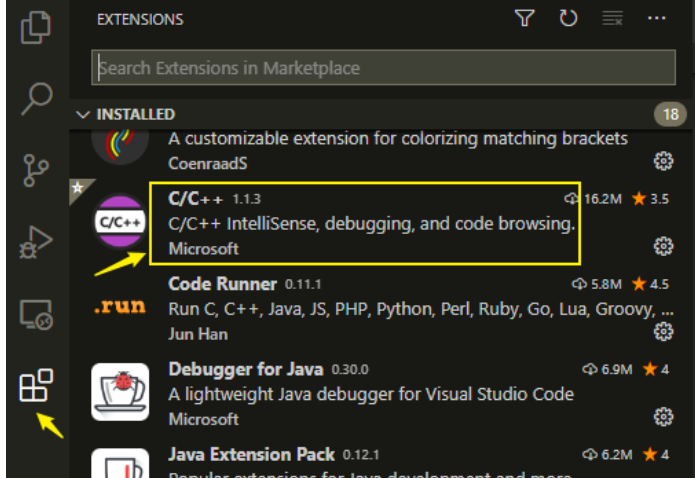
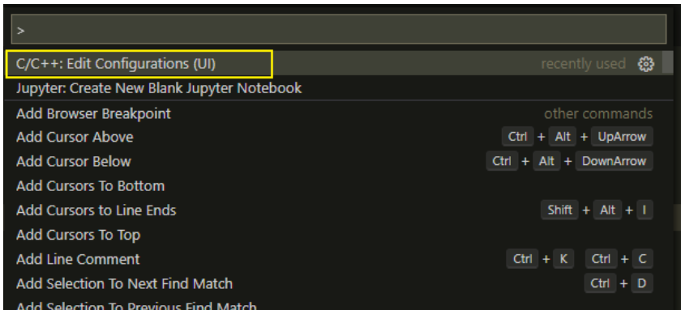
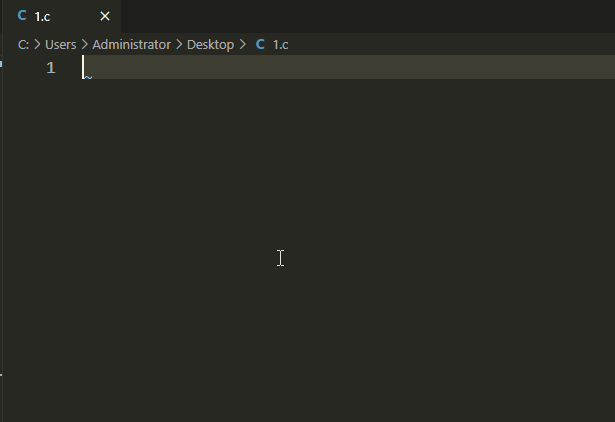

# [udf]VSCode for writing Fluent UDFs: Code Intelligent Hints settings to facilitate coding

UDF code writing with intelligent hints can significantly improve coding efficiency. Note that this setting is merely for convenience in writing code; compilation still requires the use of UDF.

UDF code writing with intelligent suggestions can significantly enhance the efficiency of coding. Note that this setting is merely for convenience in writing code; compilation still requires the use of UDF. The setup steps are as follows:

First, install VSCode and then install the C++ plugin.

-

-

Install the C/C++ plugin. This plugin is released by Microsoft, so there's nothing much to say about it; simply install it in VS Code, and after installation, all C or C++ files will be able to have syntax highlighting.

 Edit

Simple syntax highlighting is not enough; we need intelligent prompts. Here, this can be achieved by configuring the location of the header files.

-

-

Press the shortcut key `Ctrl+Shift+P` in VS Code, select the option **C/C++: Edit Configurations(UI)** as shown in the figure.

 Edit

-

-

In the opened configuration panel, find the "Include Path" option. Add the Fluent's src folder to the Include Path as shown in the figure below. Note that you need to add `**` at the end to search sub-paths.

 Edit

-

-

Restart VS Code, then write a UDF file. As shown in the figure below, you will find that there is already an intelligent hint function.

 Edit

## Payment

Here is a pay link on Stripe ( https://buy.stripe.com/3cs8yP7sY87d0vu9AB ). Please contact me lonlonago@foxmail.com after funding $89, and I will send you a complete data files , thank you!

